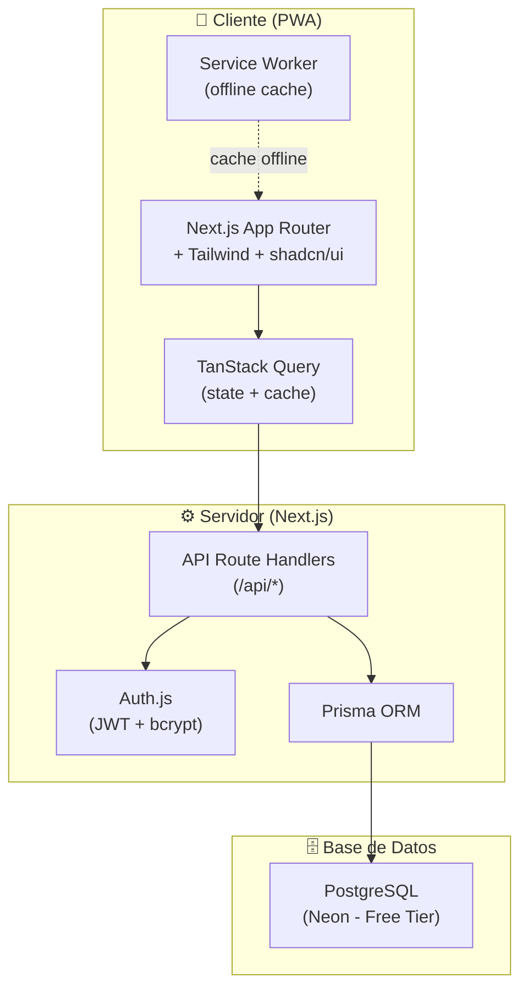
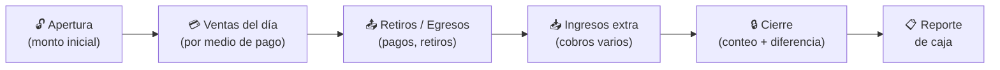

# 🥬 Doña Lorenza — Plan de Construcción del Sistema de Gestión

> **Versión:** 1.2 · **Fecha:** 25 de noviembre de 2026
> **Tipo:** Sistema POS + Gestión comercial · **Plataforma:** Web PWA (optimizada para Android)

---

## 1. Visión del Producto

Sistema de gestión integral para **Doña Lorenza** (verdulería premium, almacén, fiambrería y fabricación de sándwiches al momento) que permite operar el día a día del negocio desde cualquier dispositivo Android o desktop, con foco en:

- **Velocidad de carga de ventas** (el cajero no puede esperar)
- **Trazabilidad total** de precios históricos, costos y márgenes
- **Control de caja multi-medio de pago**
- **Gestión de stock con unidades de medida mixtas** (kg, unidad, docena, litro, etc.)

---

## 2. Stack Tecnológico Elegido

| Capa | Tecnología | Justificación |
|------|-----------|---------------|
| **Frontend** | **Next.js 14+ (App Router)** + TypeScript + Tailwind CSS + shadcn/ui | SSR/SSG, PWA nativa, excelente DX, deploy gratuito |
| **Backend / API** | **Next.js API Routes** (Route Handlers) | Monorepo, sin servidor extra, simplifica deploy |
| **Base de datos** | **PostgreSQL** (Neon free tier — 0.5 GB, always-on) | Relacional, robusto, free tier permanente con Connection Pooling serverless |
| **ORM** | **Prisma** | Type-safe, migraciones, seed, introspection (configurado con `DATABASE_URL` para pooler y `DIRECT_URL` para migraciones) |
| **Autenticación** | **NextAuth.js v5 (Auth.js)** con Credentials provider + bcrypt | Simple, JWT, sin dependencias externas de pago |
| **State / Cache** | **React Query (TanStack Query)** | Cache inteligente, offline optimistic updates |
| **PWA** | **Service Worker + Web Manifest** | Instalable en Android como app desde Chrome, diseño mobile-first táctil |
| **Hosting** | **Vercel** (free tier) o **Render** (free tier) | Ambos soportan Next.js con \$0 de costo inicial (ver sección 8) |
| **Reportes** | **Exports CSV / PDF** (y reportes en pantalla) | Descarga de listas de precios, ventas y cierres de caja (sin impresión de tickets por ahora) |

> [!TIP]
> **¿Por qué Neon en vez de Render PostgreSQL?** Render ofrece PostgreSQL gratis solo 90 días. **Neon** ofrece un free tier permanente (0.5 GB, branching, serverless) que es más que suficiente para los primeros 1-2 años de operación.

> [!IMPORTANT]
> **¿Por qué Next.js y no Laravel/PHP o .NET?** Para un proyecto que debe ser **100% gratuito en hosting**, Next.js en Vercel/Render es la opción con menor fricción. Laravel requiere un servidor PHP (de pago o con muchas restricciones en capas gratuitas), .NET requiere Azure (free tier limitado). Next.js consolida frontend + API en un solo deploy gratuito.

---

## 3. Arquitectura General



---

## 4. Módulos del Sistema

### 4.1 🔐 Módulo de Autenticación y Usuarios

| Feature | Detalle |
|---------|---------|
| Login | Usuario + contraseña individual por vendedor |
| Roles | `SUPER_ADMIN` (exclusivo para los 2 usuarios iniciales, acceso total) y `VENDEDOR` (operación diaria) |
| CRUD usuarios | **Módulo exclusivo para los 2 `SUPER_ADMIN` iniciales** (alta, baja lógica/reactivación y reseteo de clave) |
| Sesión | JWT con expiración de 8h (turno de trabajo) |
| Seguridad | Contraseñas hasheadas con bcrypt (salt rounds = 12), rate limiting en login |

**Usuarios iniciales (seed):**
- **Pablo D.** — usuario: `pablo.d` / contraseña inicial: `cookiepuki2026` → `SUPER_ADMIN` (acceso total)
- **Karina** — usuario: `karina` / contraseña inicial: `gordobachicha2026` → `SUPER_ADMIN` (acceso total)

> [!NOTE]
> Los nuevos vendedores que se den de alta desde el módulo de Usuarios recibirán el rol `VENDEDOR` (sin acceso a la gestión de usuarios ni edición de la lista de precios). Las contraseñas iniciales se cargan en el seed hasheadas con bcrypt y nunca quedan en texto plano en la base de datos.

---

### 4.2 📦 Módulo de Productos

| Feature | Detalle |
|---------|---------|
| Alta/baja/modificación | Nombre, descripción, categoría, imagen (opcional) |
| Precio de venta | Precio actual + historial completo de cambios |
| Costo de compra | Costo actual + historial completo de cambios |
| Unidades de medida | Al dar de alta un producto se selecciona su unidad de medida y **puede modificarse luego**. Además, se pueden crear/dar de baja nuevas unidades con el tiempo. Las ventas/compras/movimientos históricos conservan la unidad que tenía el producto al momento de la operación |
| **Categorías dinámicas** | **No dependen de una lista fija predefinida**: se pueden **crear, editar y dar de baja en el momento** directamente desde el módulo de productos (incluso en línea al cargar un producto nuevo) |
| Código | Código interno o código de barras (opcional) |
| Estado | Activo / Inactivo (baja lógica) |
| Margen calculado | `((precio_venta - costo_compra) / costo_compra) × 100` |

**Lista de precios:**
- Se actualiza automáticamente con los precios vigentes
- **Visible y consultable en cualquier momento** por todos los usuarios
- **Editable solo por `SUPER_ADMIN`** (`Pablo D.` y `Karina`): permite editar precios de venta y costos desde la misma lista o desde el producto, guardando cada cambio en `PriceHistory`
- Exportable a CSV / PDF
- Filtrable por categoría o búsqueda por nombre/código
- Muestra costo y margen por producto (visibles solo para `SUPER_ADMIN`)

---

### 4.3 🛒 Módulo de Ventas (POS)

| Feature | Detalle |
|---------|---------|
| Interfaz POS | Diseñada para velocidad en pantalla táctil (Android / Desktop) |
| **Precio y unidad en el momento** | Al buscar/seleccionar un producto, el sistema **trae automáticamente su precio de venta vigente y su unidad de medida** para que el cajero solo cargue la cantidad y sepa al instante cuánto cobrar |
| Búsqueda de producto | Por nombre, código o categoría (autocompletado rápido) |
| Carrito | Agregar productos, modificar cantidad, eliminar línea. Calcula subtotal por línea y **total a cobrar** en tiempo real |
| Cantidad flexible | Acepta fracciones (ej: `0.350 kg`) o enteros según la unidad del producto |
| Medios de pago | Efectivo, QR, Tarjeta débito, Tarjeta crédito, Transferencia |
| **Cálculo de vuelto y pago mixto** | Si el cliente abona en efectivo (o pago mixto donde una porción es en efectivo), el cajero ingresa el `monto_recibido` y el sistema **calcula automáticamente el vuelto**. En la venta se imputa el monto neto exacto cobrado y se registra el monto recibido y el vuelto para control de caja |
| Pago mixto | Permitir dividir una venta en múltiples medios de pago (ej. parte con transferencia y parte en efectivo) |
| **🥪 Armado de Sándwiches al momento** | Flujo rápido en mostrador para componer sándwiches sumando insumos del inventario (pan, fiambrería por gramos/unidad, agregados). El **precio de venta al cliente es la suma de los precios de venta vigentes de los ingredientes utilizados**, quedando disponible de inmediato para cobrar. Al confirmar la venta, se descuenta de stock cada insumo utilizado como venta individual con sus costos y precios históricos |
| Vendedor | Se asigna automáticamente al usuario logueado |
| Cliente | Opcional — seleccionar cliente registrado o "Consumidor final" |
| Comprobante | ⚠️ **Sin ticket ni factura AFIP por ahora** (no hay punto de venta dado de alta en AFIP). Solo confirmación visual en pantalla; la estructura queda preparada para emitir comprobantes a futuro |
| Descuento | Porcentaje o monto fijo (solo `SUPER_ADMIN` o con límite configurable) |

**Flujo rápido de venta estándar en mostrador:**
1. El cajero busca/toca el producto → el sistema trae **precio vigente** y **unidad de medida**.
2. Carga la cantidad vendida → el carrito muestra el **total a cobrar**.
3. Elige medio de pago (ej. **Efectivo** o mixto) → en la parte en efectivo ingresa el `monto_recibido` y ve el **vuelto exacto**.
4. Confirma la venta **sin emitir comprobante/ticket** → se guarda fecha/hora, vendedor, snapshot de precio de venta y costo histórico, descuenta stock y suma a la caja abierta.

**🥪 Flujo de armado de sándwiches al momento:**
1. El vendedor presiona la acción rápida **"Armar Sándwich"** en el POS.
2. Agrega los ingredientes/insumos utilizados (ej. 1 u de pan ciabatta, 0.120 kg de jamón cocido, 0.100 kg de queso tybo, tomate, aderezo).
3. **Cálculo instantáneo:** El sistema suma en vivo los precios vigentes de venta de todos los ingredientes seleccionados (`Σ(precio_ingrediente × cantidad)`) y muestra el **precio final de venta del sándwich listo para cobrar**.
4. El sándwich se añade al carrito como un ítem con el detalle de sus ingredientes.
5. Al confirmar la venta:
   - Se descuenta del stock la cantidad exacta de cada ingrediente utilizado (exactamente como si se vendieran por separado).
   - Se guarda el costo histórico sumado y el precio de venta histórico de cada componente para mantener la trazabilidad de rentabilidad.

**Datos guardados por venta:**

```
Venta
├── id, fecha_hora, vendedor_id, cliente_id (nullable)
├── subtotal, descuento, total
├── estado (completada, anulada)
│
├── VentaItem[] (líneas de venta)
│   ├── producto_id
│   ├── parent_item_id (nullable, agrupa ingredientes si pertenece a un sándwich armado)
│   ├── cantidad, unidad_medida
│   ├── precio_venta_historico (snapshot al momento de la venta)
│   ├── costo_compra_historico (snapshot al momento de la venta)
│   ├── subtotal_linea
│   └── notas (opcional: ej. "Sándwich tostado")
│
└── VentaPago[] (medios de pago)
    ├── medio_pago (EFECTIVO | QR | DEBITO | CREDITO | TRANSFERENCIA)
    ├── monto_neto (monto imputado a la venta)
    ├── monto_recibido (nullable, para arqueo cuando paga en efectivo)
    └── vuelto (nullable, calculado automáticamente)
```

> [!IMPORTANT]
> Los precios se "congelan" (snapshot) al momento de la venta. Si mañana cambia el precio, el registro histórico mantiene el precio al que se vendió.

---

### 4.4 🧾 Módulo de Compras

| Feature | Detalle |
|---------|---------|
| Registro de compra | Proveedor, fecha, productos, cantidades, costos |
| Proveedor | Alta de proveedores con datos de contacto |
| Actualización de costos | Al registrar una compra, se ofrece actualizar el costo del producto |
| Comprobante | Número de factura/remito del proveedor |
| Estado | Pendiente de pago, Pagada parcial, Pagada total |
| Cuentas por pagar | Saldo pendiente por proveedor, fecha de vencimiento |
| Medios de pago | Mismos que ventas |

**Datos guardados por compra:**

```
Compra
├── id, fecha, proveedor_id, usuario_id
├── nro_comprobante, tipo_comprobante
├── subtotal, total
├── estado_pago (PENDIENTE | PARCIAL | PAGADA)
│
├── CompraItem[]
│   ├── producto_id
│   ├── cantidad, unidad_medida
│   ├── costo_unitario
│   └── subtotal_linea
│
└── CompraPago[]
    ├── fecha_pago, medio_pago, monto
    └── observaciones
```

---

### 4.5 📊 Módulo de Stock

| Feature | Detalle |
|---------|---------|
| Stock actual | Calculado: compras acumuladas − ventas acumuladas ± ajustes |
| Ajustes manuales | Merma, rotura, consumo interno, corrección de inventario |
| Alertas | Stock bajo mínimo configurable por producto |
| Movimientos | Log de todos los movimientos (entrada por compra, salida por venta, ajuste) |
| Inventario | Función de toma de inventario físico y conciliación |
| Unidades | Respetar la unidad de medida de cada producto |

---

### 4.6 💰 Módulo de Caja

| Feature | Detalle |
|---------|---------|
| Apertura de caja | Monto inicial de efectivo, usuario que abre, fecha/hora |
| Cierre de caja | Resumen automático, usuario que cierra, fecha/hora |
| Desglose por medio de pago | Totales de: Efectivo, QR, Débito, Crédito, Transferencia |
| Movimientos de caja | Ingresos extra, retiros de efectivo (ej: pago a proveedor en efectivo) |
| Diferencia de caja | Monto esperado vs monto real declarado (solo efectivo) |
| Historial | Listado de todos los cierres con sus resúmenes |
| Acceso | Apertura/cierre por cualquier usuario; revisión detallada solo `SUPER_ADMIN` |

**Flujo de caja:**



---

### 4.7 👥 Módulo de Clientes

| Feature | Detalle |
|---------|---------|
| Alta/baja/modificación | Nombre, teléfono, email, dirección, DNI/CUIT |
| Historial de compras | Todas las ventas asociadas al cliente |
| Saldo cuenta corriente | (Fase 2 — preparado en el modelo) |
| Estado | Activo / Inactivo |
| Búsqueda | Por nombre, teléfono, DNI |

---

## 5. Modelo de Datos (PostgreSQL)

```mermaid
erDiagram
    User ||--o{ Sale : "registra"
    User ||--o{ Purchase : "registra"
    User ||--o{ CashRegister : "opera"

    Product ||--o{ PriceHistory : "tiene"
    Product ||--o{ SaleItem : "vendido en"
    Product ||--o{ PurchaseItem : "comprado en"
    Product ||--o{ StockMovement : "movimiento"
    Product }o--|| Category : "pertenece a"
    Product }o--|| UnitOfMeasure : "se mide en"

    Sale ||--|{ SaleItem : "contiene"
    Sale ||--|{ SalePayment : "pagada con"
    Sale }o--o| Customer : "asociada a"
    Sale }o--|| CashRegister : "registrada en"

    Purchase ||--|{ PurchaseItem : "contiene"
    Purchase ||--|{ PurchasePayment : "pagada con"
    Purchase }o--|| Supplier : "de proveedor"

    Customer ||--o{ Sale : "compra en"

    Supplier ||--o{ Purchase : "provee"

    CashRegister ||--|{ CashMovement : "movimientos"

    User {
        uuid id PK
        string username UK
        string password_hash
        string full_name
        enum role "SUPER_ADMIN | VENDEDOR"
        boolean is_active
        timestamp created_at
    }

    Product {
        uuid id PK
        string name
        string description
        string code UK
        uuid category_id FK
        uuid unit_of_measure_id FK
        decimal current_sale_price
        decimal current_purchase_cost
        decimal current_stock
        decimal min_stock
        string image_url
        boolean is_active
        timestamp created_at
        timestamp updated_at
    }

    PriceHistory {
        uuid id PK
        uuid product_id FK
        decimal sale_price
        decimal purchase_cost
        uuid changed_by FK
        string change_reason
        timestamp effective_from
    }

    Category {
        uuid id PK
        string name UK
        string description
        int sort_order
        boolean is_active
    }

    UnitOfMeasure {
        uuid id PK
        string name "kg, unidad, litro..."
        string abbreviation "kg, u, l, dz..."
        boolean allows_fractions
        boolean is_active
    }

    Sale {
        uuid id PK
        int sale_number
        uuid user_id FK
        uuid customer_id FK
        uuid cash_register_id FK
        decimal subtotal
        decimal discount_amount
        decimal total
        enum status "COMPLETED | VOIDED"
        timestamp created_at
    }

    SaleItem {
        uuid id PK
        uuid sale_id FK
        uuid product_id FK
        uuid parent_item_id FK "nullable, agrupa ingredientes de un sándwich"
        decimal quantity
        string unit_abbreviation
        decimal unit_sale_price
        decimal unit_purchase_cost
        decimal line_total
        string notes "nullable"
    }

    SalePayment {
        uuid id PK
        uuid sale_id FK
        enum payment_method "CASH | QR | DEBIT | CREDIT | TRANSFER"
        decimal amount "monto neto imputado a la venta"
        decimal tendered_amount "monto entregado (efectivo)"
        decimal change_amount "vuelto entregado"
    }

    Customer {
        uuid id PK
        string full_name
        string phone
        string email
        string address
        string tax_id "DNI/CUIT"
        decimal credit_balance "para cuenta corriente futura"
        boolean is_active
        timestamp created_at
    }

    Purchase {
        uuid id PK
        int purchase_number
        uuid supplier_id FK
        uuid user_id FK
        string voucher_number
        string voucher_type
        decimal subtotal
        decimal total
        enum payment_status "PENDING | PARTIAL | PAID"
        date due_date
        timestamp created_at
    }

    PurchaseItem {
        uuid id PK
        uuid purchase_id FK
        uuid product_id FK
        decimal quantity
        string unit_abbreviation
        decimal unit_cost
        decimal line_total
    }

    PurchasePayment {
        uuid id PK
        uuid purchase_id FK
        date payment_date
        enum payment_method "CASH | QR | DEBIT | CREDIT | TRANSFER"
        decimal amount
        string notes
    }

    Supplier {
        uuid id PK
        string name
        string contact_name
        string phone
        string email
        string address
        string tax_id
        boolean is_active
    }

    CashRegister {
        uuid id PK
        uuid opened_by FK
        uuid closed_by FK
        decimal opening_amount
        decimal expected_cash
        decimal declared_cash
        decimal difference
        enum status "OPEN | CLOSED"
        timestamp opened_at
        timestamp closed_at
    }

    CashMovement {
        uuid id PK
        uuid cash_register_id FK
        uuid user_id FK
        enum type "INCOME | EXPENSE"
        decimal amount
        string description
        timestamp created_at
    }

    StockMovement {
        uuid id PK
        uuid product_id FK
        uuid user_id FK
        enum type "PURCHASE_IN | SALE_OUT | ADJUSTMENT_IN | ADJUSTMENT_OUT | INVENTORY"
        decimal quantity
        string unit_abbreviation
        decimal stock_after
        string reference_id "ID de venta, compra o ajuste"
        string notes
        timestamp created_at
    }
```



---

## 6. Estructura del Proyecto

```
dona-lorenza/
├── prisma/
│   ├── schema.prisma          # Modelo de datos
│   ├── seed.ts                # Datos iniciales (Pablo D., Karina, UoM base)
│   └── migrations/
│
├── src/
│   ├── app/                   # Next.js App Router
│   │   ├── (auth)/
│   │   │   └── login/page.tsx
│   │   │
│   │   ├── (dashboard)/       # Layout protegido
│   │   │   ├── layout.tsx     # Sidebar + header + nav móvil Android
│   │   │   ├── page.tsx       # Dashboard principal
│   │   │   │
│   │   │   ├── pos/           # 🛒 Punto de venta (precios vigentes + vuelto)
│   │   │   │   └── page.tsx
│   │   │   │
│   │   │   ├── productos/     # 📦 ABM Productos + Categorías y Unidades dinámicas
│   │   │   │   ├── page.tsx
│   │   │   │   └── [id]/page.tsx
│   │   │   │
│   │   │   ├── ventas/        # 📋 Historial de ventas
│   │   │   │   ├── page.tsx
│   │   │   │   └── [id]/page.tsx
│   │   │   │
│   │   │   ├── compras/       # 🧾 Registro de compras + Cuentas por pagar
│   │   │   │   ├── page.tsx
│   │   │   │   ├── nueva/page.tsx
│   │   │   │   └── [id]/page.tsx
│   │   │   │
│   │   │   ├── stock/         # 📊 Control de stock
│   │   │   │   └── page.tsx
│   │   │   │
│   │   │   ├── caja/          # 💰 Control y cierre de caja
│   │   │   │   ├── page.tsx
│   │   │   │   └── historial/page.tsx
│   │   │   │
│   │   │   ├── clientes/      # 👥 Gestión de clientes
│   │   │   │   ├── page.tsx
│   │   │   │   └── [id]/page.tsx
│   │   │   │
│   │   │   ├── proveedores/   # 🏭 Gestión de proveedores
│   │   │   │   ├── page.tsx
│   │   │   │   └── [id]/page.tsx
│   │   │   │
│   │   │   ├── lista-precios/ # 💲 Lista de precios (editable solo SUPER_ADMIN)
│   │   │   │   └── page.tsx
│   │   │   │
│   │   │   └── usuarios/      # 🔐 ABM Usuarios (exclusivo 2 SUPER_ADMIN)
│   │   │       └── page.tsx
│   │   │
│   │   └── api/               # Route Handlers
│   │       ├── auth/[...nextauth]/route.ts
│   │       ├── products/route.ts
│   │       ├── categories/route.ts
│   │       ├── units/route.ts
│   │       ├── sales/route.ts
│   │       ├── purchases/route.ts
│   │       ├── stock/route.ts
│   │       ├── cash-register/route.ts
│   │       ├── customers/route.ts
│   │       ├── suppliers/route.ts
│   │       ├── users/route.ts
│   │       └── reports/route.ts
│   │
│   ├── components/
│   │   ├── ui/                # shadcn/ui components
│   │   ├── layout/            # Sidebar, Header, MobileNav
│   │   ├── pos/               # Componentes del POS
│   │   ├── forms/             # Formularios reutilizables
│   │   └── tables/            # Tablas con filtros y paginación
│   │
│   ├── lib/
│   │   ├── prisma.ts          # Singleton Prisma Client
│   │   ├── auth.ts            # Configuración Auth.js
│   │   ├── utils.ts           # Helpers
│   │   └── validators/        # Zod schemas
│   │
│   ├── hooks/                 # Custom React hooks
│   │
│   └── types/                 # TypeScript types
│
├── public/
│   ├── manifest.json          # PWA manifest
│   ├── icons/                 # App icons para PWA
│   └── sw.js                  # Service Worker (generado)
│
├── .env.local                 # Variables de entorno
├── next.config.js
├── tailwind.config.ts
├── tsconfig.json
├── package.json
└── README.md
```

---

## 7. Plan de Ejecución por Fases

### Fase 0 — Setup Inicial 🏗️

| # | Tarea | Detalle |
|---|-------|---------|
| 0.1 | Crear proyecto Next.js | `npx create-next-app@latest dona-lorenza --typescript --tailwind --app --src-dir` |
| 0.2 | Instalar dependencias | Prisma, Auth.js, shadcn/ui, TanStack Query, zod, bcrypt, date-fns |
| 0.3 | Configurar Prisma + Neon | Crear DB en Neon, configurar `DATABASE_URL` (connection pooling para Vercel) y `DIRECT_URL` (conexión directa para migraciones) |
| 0.4 | Definir `schema.prisma` | Todas las tablas del modelo de datos |
| 0.5 | Crear `seed.ts` | Cargar a **Pablo D.** (`pablo.d`) y **Karina** (`karina`) como `SUPER_ADMIN` y las unidades de medida base (categorías se crean dinámicamente en el módulo) |
| 0.6 | Configurar Auth.js | Credentials provider + middleware de protección de rutas por rol |
| 0.7 | Layout base mobile-first | Sidebar desktop + barra/menú táctil Android, header con usuario, theme dark/light |
| 0.8 | Configurar PWA | `manifest.json`, service worker e íconos para instalar en Android |

---

### Fase 1 — Productos, Categorías, Unidades y Lista de Precios 📦

| # | Tarea | Detalle |
|---|-------|---------|
| 1.1 | API CRUD productos | Create, Read, Update (incluyendo cambio de unidad de medida), Soft Delete |
| 1.2 | API historial de precios | Registrar automáticamente cada cambio en `PriceHistory` |
| 1.3 | CRUD categorías dinámicas | Alta, edición y baja lógica en el momento desde Productos (sin listado fijo) |
| 1.4 | CRUD unidades de medida | Alta y baja lógica de unidades con flag `allows_fractions`; seleccionables y modificables por producto |
| 1.5 | UI tabla y formulario de productos | Listado con búsqueda, filtros por categoría, alta rápida de categoría en el formulario y validación (Zod) |
| 1.6 | UI lista de precios | Consultable en cualquier momento por todo el equipo; **edición de precios/costos habilitada solo para `SUPER_ADMIN`** + export CSV/PDF |

---

### Fase 2 — Módulo POS / Ventas 🛒

| # | Tarea | Detalle |
|---|-------|---------|
| 2.1 | UI Punto de Venta | Interfaz táctil-friendly, búsqueda rápida que **trae precio de venta vigente y unidad al instante** |
| 2.2 | Lógica de carrito | Agregar, quitar, modificar cantidad (fracciones o enteros según unidad), calcular subtotales y **total a cobrar** |
| 2.3 | **Flujo "Armar Sándwich"** | Modal/selector ágil de ingredientes (pan, fiambres/quesos por peso o unidad); **calcula en el momento el precio de venta total sumando los ingredientes vigentes** para cobrar inmediatamente |
| 2.4 | Medios de pago y vuelto | Efectivo, QR, Débito, Crédito, Transferencia o pago mixto + **calculadora de vuelto** con campo auxiliar `monto_recibido` e imputación del monto neto en la venta |
| 2.5 | API registrar venta | Crear venta + items (agrupando ingredientes de sándwiches con `parent_item_id`) + pagos en transacción atómica (sin emitir ticket ni AFIP) |
| 2.6 | Snapshot histórico | Guardar precio de venta vigente, costo de compra vigente y abreviatura de unidad al momento de la venta por cada ítem/ingrediente |
| 2.7 | Confirmación de venta en pantalla | Resumen rápido de venta registrada para el cajero (sin impresión ni AFIP por ahora) |
| 2.8 | Historial de ventas | Listado con fecha/hora, vendedor, cliente, medio de pago, detalle de sándwiches/ingredientes, precios históricos y margen |
| 2.9 | Detalle y anulación de venta | Vista completa de líneas/pagos; anulación solo `SUPER_ADMIN` con motivo |
| 2.10 | Descontar stock | Al registrar venta, descontar stock de productos individuales y de cada ingrediente utilizado en sándwiches armados |

---

### Fase 3 — Módulo de Compras 🧾

| # | Tarea | Detalle |
|---|-------|---------|
| 3.1 | CRUD proveedores | Alta/baja/modificación de proveedores |
| 3.2 | UI registro de compra | Formulario con proveedor, comprobante recibido, productos, cantidades, costos y vencimiento |
| 3.3 | API registrar compra | Crear compra + items + estado de pago (`PENDING` / `PARTIAL` / `PAID`) |
| 3.4 | Actualizar costos | Opción de actualizar el costo vigente del producto al registrar compra (registrando en `PriceHistory`) |
| 3.5 | Registrar pagos | Pagos parciales/totales contra compras pendientes (Efectivo, QR, Débito, Crédito, Transferencia) |
| 3.6 | Cuentas por pagar | Vista de saldos pendientes por proveedor y próximos vencimientos |
| 3.7 | Sumar stock | Al registrar compra, sumar stock y generar `StockMovement` |

---

### Fase 4 — Control de Stock 📊

| # | Tarea | Detalle |
|---|-------|---------|
| 4.1 | Vista de stock actual | Tabla con stock por producto en su unidad vigente y alertas de stock mínimo |
| 4.2 | Ajustes manuales | Registrar merma, rotura, consumo interno o corrección |
| 4.3 | Historial de movimientos | Log filtrable por producto, tipo, usuario y fecha |
| 4.4 | Toma de inventario | Interfaz para contar stock físico y conciliar diferencias |
| 4.5 | Alertas de stock bajo | Badge/notificación en dashboard para reposición |

---

### Fase 5 — Control y Cierre de Caja 💰

| # | Tarea | Detalle |
|---|-------|---------|
| 5.1 | Apertura de caja | Registrar monto inicial en efectivo y abrir sesión de caja |
| 5.2 | Movimientos de caja | Ingresos/egresos manuales (retiros, pagos a proveedores en efectivo, etc.) |
| 5.3 | Cierre de caja | Desglose automático por medio de pago (**Efectivo, QR, Débito, Crédito, Transferencia**) + conteo real de efectivo |
| 5.4 | Diferencia de caja | Comparar efectivo esperado vs declarado |
| 5.5 | Historial de cajas | Listado de sesiones con resumen (revisión detallada restringida a `SUPER_ADMIN`) |
| 5.6 | Validación operativa | Exigir caja abierta para registrar ventas |

---

### Fase 6 — Clientes y Usuarios 👥🔐

| # | Tarea | Detalle |
|---|-------|---------|
| 6.1 | CRUD clientes | Alta, baja lógica, modificación (nombre, teléfono, email, dirección, DNI/CUIT) |
| 6.2 | Historial por cliente | Ventas asociadas a un cliente (base lista para futuras cuentas corrientes) |
| 6.3 | Búsqueda de clientes | En el POS, autocompletado opcional |
| 6.4 | CRUD usuarios | **Accesible únicamente por los 2 `SUPER_ADMIN` iniciales** (`Pablo D.` y `Karina`) para dar de alta/baja vendedores |
| 6.5 | Cambiar contraseña | El propio usuario puede cambiar su contraseña y los `SUPER_ADMIN` pueden resetear claves |

---

### Fase 7 — Dashboard y Reportes 📈

| # | Tarea | Detalle |
|---|-------|---------|
| 7.1 | Dashboard principal | Ventas del día, top productos, alertas de stock, estado de caja |
| 7.2 | Reporte de ventas | Por rango de fechas, vendedor y medio de pago |
| 7.3 | Reporte de márgenes | Rentabilidad histórica real (precio de venta histórico vs costo de compra histórico) |
| 7.4 | Reporte de compras y deuda | Gastos por proveedor y estado de cuentas por pagar |
| 7.5 | Gráficos | Evolución de ventas y distribución por medio de pago |

---

### Fase 8 — PWA, Testing y Deploy 🚀

| # | Tarea | Detalle |
|---|-------|---------|
| 8.1 | PWA completa | Manifest, icons, install prompt en Android (Chrome → "Agregar a pantalla de inicio") |
| 8.2 | Testing E2E | Flujos críticos: login → carga de producto → venta con vuelto → cierre de caja |
| 8.3 | Responsive final | QA táctil en dispositivos Android reales y desktop |
| 8.4 | Deploy gratuito | Publicar en **Vercel + Neon** (o **Render + Neon**) con CI/CD desde GitHub |
| 8.5 | Seed de producción | Ejecutar seed inicial con `Pablo D.`, `Karina` y unidades de medida base |

---

## 8. Hosting Gratuito — Opciones Comparadas

| Plataforma | App | DB | Límites free | Mejor para |
|-----------|-----|-----|-------------|------------|
| **Vercel** | ✅ Next.js nativo | ❌ (usar Neon) | 100 GB bandwidth/mes, serverless | ⭐ **App recomendada** |
| **Render** | ✅ Web Service | ⚠️ PostgreSQL gratis expira a los 90 días | 750 hs/mes, spin-down tras 15 min inactivo (~30-50s al despertar) | Alternativa si se prefiere servidor tradicional |
| **Neon** | ❌ | ✅ PostgreSQL | 0.5 GB permanente, branching | ⭐ **DB recomendada** |
| **Railway** | ✅ | ✅ | Crédito trial limitado / luego pago | No recomendado para \$0 permanente |

> [!NOTE]
> **Arquitectura \$0/mes recomendada:** **Vercel** (app Next.js) + **Neon** (PostgreSQL). Evita la expiración de DB a los 90 días de Render y evita las pausas de 30-50 segundos por *spin-down* en medio de la atención al público en mostrador. Si se eligiera **Render** para la app, igualmente se recomienda conectarlo a **Neon** como base de datos para no perder la DB a los 90 días.

---

## 9. Consideraciones de Seguridad

| Aspecto | Implementación |
|---------|---------------|
| Contraseñas | bcrypt con salt rounds = 12 |
| Autenticación | JWT con expiración 8h (turno de trabajo) |
| Autorización | Middleware que verifica rol en cada API route (`SUPER_ADMIN` requerido en Usuarios y edición de Lista de Precios) |
| Validación | Zod en frontend y backend (doble validación) |
| SQL Injection | Prisma ORM (queries parametrizadas) |
| XSS | React escaping nativo + sanitización de inputs |
| CSRF | SameSite cookies + Origin check |
| Rate Limiting | En endpoint de login (5 intentos / 15 min) |
| Variables | Secrets en variables de entorno, nunca en código |

---

## 10. Preparación para el Futuro (Fase 2+)

Estos features están **contemplados en el modelo de datos** pero se desarrollarán después:

| Feature | Preparación actual |
|---------|-------------------|
| **Cuentas corrientes** | Campo `credit_balance` en `Customer` y base lista para tabla de movimientos de cuenta corriente |
| **Facturación electrónica AFIP / Tickets** | Estructura de `Sale` y `SaleItem` preparada para emitir factura electrónica / comprobante cuando se dé de alta el punto de venta |
| **App nativa Android** | PWA ya es instalable; migrar a React Native si se necesita hardware nativo |
| **Múltiples sucursales** | Agregar `branch_id` a las entidades principales |
| **Delivery** | Módulo de pedidos con estados y dirección de entrega |
| **Fidelización** | Puntos por compra, descuentos por cliente frecuente |
| **Integración MercadoPago** | API de pagos para cobro con QR propio |

---

## 11. Resumen Ejecutivo

```
📦 Módulos: 7 principales + dashboard
🛠️ Stack: Next.js + PostgreSQL + Prisma + Auth.js
💰 Costo mensual: $0 (Vercel + Neon free tier)
📱 Android: PWA instalable desde el navegador
🧾 Comprobantes: Sin tickets ni AFIP por ahora (preparado a futuro)
👥 Usuarios iniciales: 2 × SUPER_ADMIN (Pablo D. y Karina)
🔐 Seguridad: JWT + bcrypt + Zod + control estricto de roles
```

---

## 12. Decisiones Confirmadas ✅

| # | Aspecto | Definición confirmada |
|---|---------|----------------------|
| 1 | **Usuarios admin iniciales** | `Pablo D.` (`pablo.d` / `cookiepuki2026`) y `Karina` (`karina` / `gordobachicha2026`) — únicos con acceso al módulo de usuarios y edición de lista de precios |
| 2 | **Categorías** | 100% dinámicas: se dan de alta, editan y dan de baja en el momento desde el módulo de productos (no solo predefinidas) |
| 3 | **Unidades de medida** | Base inicial configurable (kg, g, u, dz, l, ml, m, at, bj, paq, bot) + alta de nuevas unidades. Al crear un producto se elige su unidad y se puede cambiar luego sin alterar el historial |
| 4 | **POS y Lista de precios** | La lista de precios se consulta en todo momento y solo `SUPER_ADMIN` la edita. En ventas se trae producto y precio vigente al instante, calcula total y vuelto en efectivo |
| 5 | **Comprobantes / AFIP** | Sin tickets ni factura electrónica por ahora (sin punto de venta AFIP aún); queda contemplado a futuro |
| 6 | **Hosting** | A criterio técnico → **Vercel (app) + Neon (PostgreSQL)** = **\$0/mes** |
| 7 | **Logo/branding** | Pendiente de recibir. Arrancar con diseño genérico (paleta verde, placeholder de logo) |
| 8 | **Armado de sándwiches al momento** | Se componen seleccionando los insumos (pan, fiambrería por gramos/unidad, agregados). El precio de venta al cliente es la suma en vivo de los precios de venta vigentes de los ingredientes. Al confirmar, se descuenta de stock cada insumo individualmente con su costo y precio histórico |
| 9 | **Vuelto y pagos mixtos** | La UI incluye campo auxiliar `monto_recibido` para calcular el vuelto en efectivo. En la base de datos se imputa el monto neto cobrado en `SalePayment.amount` y se guardan `tendered_amount` y `change_amount` para control de caja |
| 10 | **Conexión Neon Serverless** | Prisma se configura con `DATABASE_URL` (connection pooler) para prevenir saturación de conexiones en serverless y `DIRECT_URL` para migraciones |

> [!NOTE]
> **Alcance actual:** Este documento define exclusivamente la planificación del sistema para Doña Lorenza (sin desarrollo de código en esta etapa).
